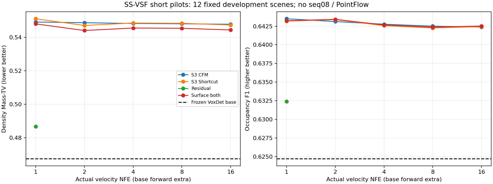
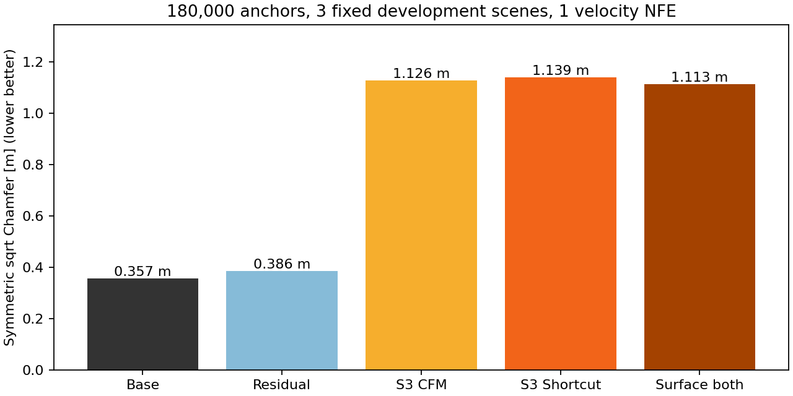

# SS-VSF initial implementation / pilot results

**机制验证通过，质量 gate 未通过，未启动正式长训。** 以下均是2026-10-13短pilot，不能作为论文结论；Stage2没有改动或联合训练。

## Scope and provenance

旧VoxDet density 25k checkpoint只用于warmstart。新独立65参数occupancy head经过64次双卡更新后冻结，checkpoint SHA256为 `b066dbf1df84931ba110bb593a2bc5f8f2e566716d298e4583a2c2e6dfd5931a`。Base pilot实际使用89个严格有效training帧池、10个development帧池；之后按显式边界过滤协议扩展为100个固定training帧和12个development帧。Base训练的原始cohort已单独保存 `base_hurdle_pilot/manifest_at_run.json`，不能把它表述为在全部17,870帧训练过。

最终检查发现并修复了继承activation checkpoint wrapper的BatchNorm重复统计更新。新encoder只隔离recompute buffers，不改网络结构、参数或正常forward。CPU普通/checkpoint梯度与buffers一致，修复后的GPU2+3 DDP4步检查所有BN统计各更新4次。**上述冻结base64步pilot在修复前生成**，本报告不替换其权重或重标结果；所有correction使用同一原checkpoint，eval路径不进行checkpoint重算。正式base训练必须重新使用修复后的adapter，现有pilot是带此训练期限制的诊断证据。

所有correction实验使用相同100帧池、同一冻结base、n_ref24、gate0.7和source seed。CFM与residual各64成功更新；Shortcut从对应CFM初始化，再64更新；surface和无surface continuation从同一S3 Shortcut初始化，各额外32更新。累计correction更新数分别64、128、160。**不同阶段总预算不同，所有模型均未充分收敛。** 评测统一12个development帧，额外180k-anchor诊断使用其中相同3帧 `00/000500,05/000508,10/000599`。没有使用seq08调参或测试。

Source门限0.7由12帧development上的normalized density Mass-TV从0.3/0.5/0.7中选择；噪声0.05保留预设候选，并未据seq08选择。noise诊断显示source-only Mass-TV随unknown sigma0.02/0.05/0.10约为0.5055/0.5581/0.6317；确定性base为0.4673。这些diagnostics需要正式训练前重新验证和登记，不能直接把最好的短pilot门限当成最终论文协议。

## Density results

表中NFE只计velocity evaluations，每帧另有1次VoxDet base forward。Base占用阈值和correction评测阈值均为count≥1；metrics为逐帧macro平均。

| Method | Velocity NFE | Mass-TV ↓ | Occ IoU ↑ | Occ F1 ↑ |
|---|---:|---:|---:|---:|
| Frozen VoxDet Base | 0 | 0.4673 | 45.74% | 62.47% |
| Gaussian CFM | 1 | 0.9551 | 1.73% | 3.40% |
| S1 direct Residual | 1 | 0.4866 | 46.53% | 63.24% |
| S2 CFM | 1 | 0.5492 | 47.74% | 64.31% |
| S2 CFM | 4 | 0.5483 | — | 64.24% |
| S2 CFM | 16 | 0.5478 | — | 64.21% |
| S3 CFM | 1 | 0.5492 | 47.78% | 64.35% |
| S3 CFM | 2 | 0.5488 | — | 64.31% |
| S3 CFM | 4 | 0.5483 | — | 64.28% |
| S3 CFM | 8 | 0.5481 | — | 64.25% |
| S3 CFM | 16 | 0.5479 | — | 64.24% |
| S3 Shortcut | 1 | 0.5511 | 47.75% | 64.32% |
| S3 Shortcut | 2 | 0.5471 | — | 64.34% |
| S3 Shortcut | 4 | 0.5486 | — | 64.26% |
| S3 Shortcut | 8 | 0.5484 | — | 64.23% |
| S3 Shortcut | 16 | 0.5474 | — | 64.24% |
| Continuation, no surface | 1 | 0.5512 | 47.74% | 64.31% |
| Surface occupancy | 1 | 0.5498 | 47.75% | 64.32% |
| Surface multiscale | 1 | 0.5483 | 47.75% | 64.33% |
| Surface both | 1 | 0.5481 | 47.75% | 64.32% |

完整47行、multiscale TV、count MAE、log-count MAE和raw mass calibration在 [nfe_table.csv](ss_vsf_reports/nfe_table.csv) 及逐帧JSON。最终归一化后的mass calibration接近0是构造结果，不能用于宣称模型数量标定已经准确；raw base质量使用未gate/归一化前的预测，flow raw质量使用解码后归一化前的count。



S3 Shortcut的16步实际路径平均R=1.00448、相邻velocity cosine=0.99769，但mapped endpoint GT RMSE仍为0.13501。**近直路径并没有证明正确终点。** 原始逐帧trajectory字段包含与16NFE终点差异和GT误差。

## 180k anchor quality gate

以下是3个固定development帧的180,000 Gaussian voxel anchors，**没有PointFlow**。CD为双向nearest-distance均值的0.5倍，单位m；F-score/coverage阈值20cm。KNN使用FP32 KeOps，不创建dense180k×180k矩阵。

| Method | Velocity NFE | CD ↓ | F20 ↑ | Coverage20 ↑ |
|---|---:|---:|---:|---:|
| Frozen Base | 0 | 0.3567 | 63.43% | 72.46% |
| Residual | 1 | 0.3859 | 60.98% | 71.30% |
| S3 CFM | 1 | 1.1258 | 53.50% | 66.26% |
| S3 Shortcut | 1 | 1.1386 | 53.31% | 66.14% |
| S3 Shortcut | 16 | 1.1135 | 53.86% | 66.47% |
| Surface both | 1 | 1.1132 | 53.75% | 66.45% |
| Surface both | 16 | 1.0868 | 54.22% | 66.68% |



占用F1小幅提高，point-source质量显著下降。三帧GT空体素上的质量占比：base39.83%，noisy source53.30%，组合surface一步52.22%。该诊断支持background mass leakage是当前重要问题，不能只根据F1或FM loss下降启动正式长训。所有anchors都满足球/圆盘/对应voxel交集，out-of-range比例0；这不是通过越界裁点补数得到的结果。

## Resource audit

| Model / training mode | Parameters | Peak allocated VRAM | Median warm update |
|---|---:|---:|---:|
| Base FP16 DDP, B1/GPU | 22,082,535 | GPU2 5.06GiB | GPU2 0.716s |
| S3 CFM FP16, B1 | 528,081 correction + frozen base | 1.62GiB | 0.256s |
| S3 Shortcut FP16, B1 | 同上 + EMA | 2.18GiB | 0.581s |
| Surface both FP16, B1 | 同上 + EMA | 2.18GiB | 0.588s |

Warm inference base约146ms，1NFE correction+decode约27ms；因此1NFE Stage1为约173ms加source构造。CPU allocation+truncated anchor sampling在3帧S3 Shortcut一步诊断中的中位数约246ms，单独计时。正式PointFlow latency没有测量，不能将上述值称作最终pipeline延迟。first-frame冷启动/编译开销不计入warm数值；原始文件保留所有测量。

当前velocity U-Net是小容量correctness/pilot配置，不是3090显存或吞吐优化结果；没有缩减体素分辨率或每帧anchor点数来换取通过。Base/CFM/Shortcut均已通过physical GPU2、3单卡验证和DDP4步；成功updates均梯度finite、AMP跳步0。Base后补的GPU2 FP16和GPU3 FP32 smoke也使用最终65参数head版本。

## GT-free five-frame export

真实input-only帧 `00_000000,00_000180,00_000360,00_000681,00_000861` 已在GPU2完成1NFE导出。

每帧density和allocated_counts为 `[32,256,256]`；整数counts精确和为180,000；source_anchors为float32 `[180000,3]`，IDs重新voxelize后逐点一致；sphere/circle/voxel bounds全部PASS。推理manifest只接受id/input，出现GT、semantic、Teacher或condition-features字段会拒绝。未加载GT，未调用Teacher、Sinkhorn、PointFlow，未导出C。

本地完整输出路径：

`/data-12/M2024-HWZ/FPSGen/experiments/voxel_shortcut/initial/inference_5_frames`

点云、density caches、checkpoint和环境不提交Git。小型验证结果在 [inference_validation.json](ss_vsf_reports/inference_validation.json)。

## Final Codex report

```text
Repository: shuaiqianende/FPSGen-private
Branch: research/fpsgen-v2
HEAD before: 1ddadc66be437220589eca21710a0b46a37283e3
Implementation revision: the commit containing this report on private research/fpsgen-v2
Upload target: shuaiqianende/FPSGen-private (never public origin)
Existing modifications preserved: YES
System environment modified: NO
Environment: FPSGen/env/voxdet_voxel_shortcut
Physical GPUs: 2,3 only

Geometry: 256x256x32, [-50,50]x[-50,50]x[-4,4.4]
GT crop: 3D radius<50m, audited <=1mm boundary filtering
Generated point budget: 180000
GT actual retained mass: 179987..180000, no repetition/repair
Geometry validation: PASS

VoxDet upstream: e10d8280de96d4f03f54b616e57e7c6754044fa4
Tokenizer/backbone/necks/six-direction refinement preserved: YES
Adaptation: XYZ-only radial6th feature; sphere geometry;
            density targets; independent65-parameter occupancy head
Base parameters: 22082535
LiDAR feature leakage: NONE
Base metrics: IoU45.74%, F162.47%, Mass-TV0.4673 (12dev pilot)

Structured source: frozen predicted density + input-hit noise
GT source leakage: NONE
Raw voxel FM: [B,1,32,256,256]
Gaussian/structured CFM mechanics: PASS
Time embedding/step embedding/EMA/bootstrap/endpoint mechanics: PASS
Surface occupancy/multiscale/both mechanics: PASS
GPU2/GPU3/DDP correctness: PASS
CPU tests: 40 PASS (new + existing voxel_point)

Anchor interface: PASS
Exact allocated points: 180000
Source anchors: [180000,3]
Sphere/circle/voxel consistency: PASS
Five real frames GT-free export: PASS
Stage2 hidden-feature transfer: NONE
Stage2 modified/trained: NO

Structured source helps: INCONCLUSIVE
Shortcut improves low-NFE quality: INCONCLUSIVE
Surface supervision helps: INCONCLUSIVE
Best NFE: NOT FROZEN; quality gate failed
Ready for formal training: NO
Automatic long-training queues: NONE
Blocker: background mass leakage and degraded180k-anchor geometry
Additional single-card checks: not run after approval-service credit failure
```

下一阶段应先登记更充分的100–500更新pilot和capacity/source-noise/endpoint-loss控制实验，检查背景质量与anchor CD是否恢复，再决定正式预算。不要只延长当前配置并把损失下降视作质量gate通过。三种研究假设均保留为INCONCLUSIVE；这轮交付的是可运行实现、资源证据与失败诊断。

Git发布在用户随后明确要求上传结果后单独执行；此前额度故障未执行的额外GPU验证仍标记为未运行，不因代码上传而改变测试结论。

## Reproduce

完整源配置在 `configs/research_v2/voxel_shortcut`。正式配置保留 `base_checkpoint: null` 和未冻结source gate，要求用户选定真正冻结的base并完成development校准；不会直接启动正式队列。运行时pilot配置与exact配置快照位于ignored的 `experiments/voxel_shortcut/initial/configs` 和各run目录。

```bash
OMP_NUM_THREADS=4 env/voxdet_voxel_shortcut/bin/python -m pytest -q tests/test_voxel_shortcut.py tests/test_voxel_point.py

CUDA_VISIBLE_DEVICES=2 env/voxdet_voxel_shortcut/bin/python scripts/research_v2/voxel_shortcut/train_structured_cfm.py --config experiments/voxel_shortcut/initial/configs/observation_cfm.yaml --output experiments/voxel_shortcut/reproduce_cfm --pilot --max-steps 64

CUDA_VISIBLE_DEVICES=3 env/voxdet_voxel_shortcut/bin/python scripts/research_v2/voxel_shortcut/eval_nfe_curve.py --config experiments/voxel_shortcut/initial/configs/eval_observation_shortcut.yaml --output experiments/voxel_shortcut/reproduce_eval --max-frames 12

env/voxdet_voxel_shortcut/bin/python scripts/research_v2/voxel_shortcut/summarize_pilot.py --experiment-root experiments/voxel_shortcut/initial --output docs/research_v2/ss_vsf_reports
```

所有experiment config SHA、base/flow checkpoint SHA、各阶段resource summary和逐帧metrics保存在 [ss_vsf_reports](ss_vsf_reports)。报告包含绝对数据路径和计数/指标，不包含真实XYZ、隐藏features或模型weights。
